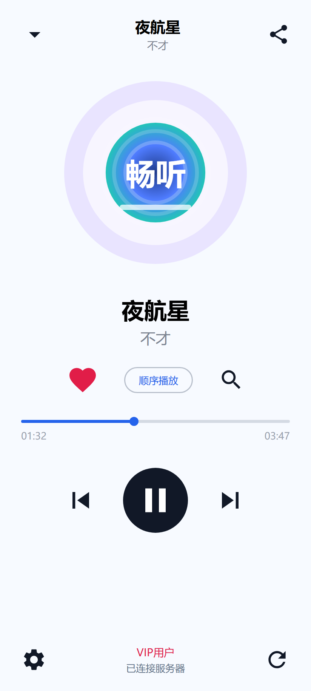
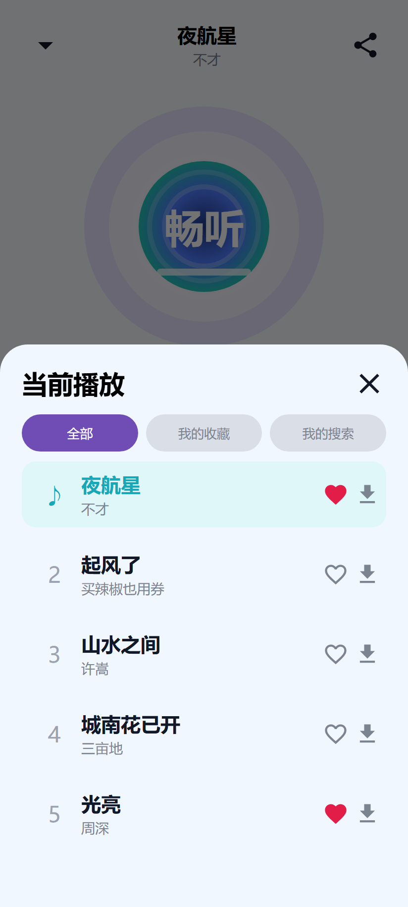
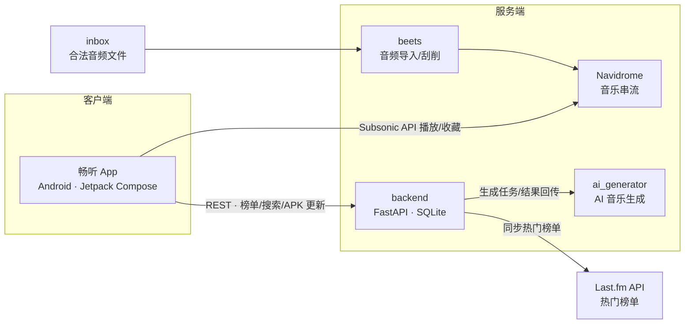

  

<h1 align="center">畅听 · 自建音乐库</h1>

自研音频播放器：FastAPI 后台 + Navidrome 串流 + 安卓客户端 + AI 音乐生成

## 界面预览

  
  &nbsp;&nbsp;
  

> 界面图基于 `android/` 中 Compose 代码还原绘制，实际效果以真机为准。

## 系统架构

代码分为三部分：

- `backend`：后台服务、Last.fm 热门榜单同步、合法音频导入、Navidrome Docker 配置、beets 配置。
- `android`：安卓音乐客户端，中文界面，连接 Navidrome 播放音乐。
- `ai_generator`：AI 音乐生成服务，供 `backend` 的 `ai_music` 路由调用。

## 推荐落地顺序

1. 本地运行 `backend`，确认 API 能打开。
2. 申请 Last.fm API Key，写入 `backend/.env`。
3. 把合法音频放入 `backend/data/inbox`。
4. 用后台接口或 beets 导入音乐。
5. 启动 Navidrome，创建管理员账号。
6. 安卓 App 填 Navidrome 地址和账号。

## 环境建议

- 后台：Python 3.12 或 Docker。
- 安卓：Android Studio Koala 或更新版本、JDK 17、Android SDK 35。

## 重要说明

本项目不会实现自动下载版权音乐。热门榜单只作为发现和参考数据；真正入库的音频必须来自合法来源。
